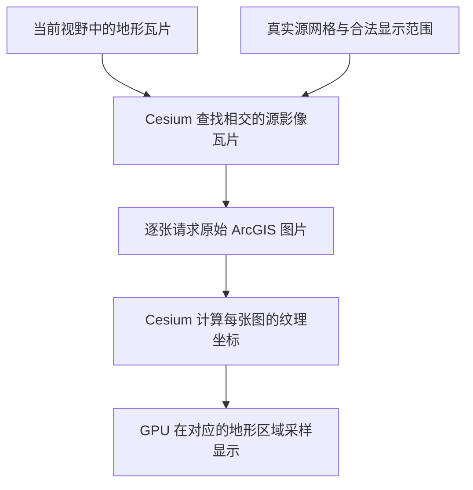

# 实现原理：保留源网格，直接显示源瓦片

本项目让 Cesium 的**影像网格采用 ArcGIS 服务的实际网格**。地形网格保持原样，一块地形可以使用多张相交的源影像。每个影像请求仍返回一张完整原图，由 Cesium 计算纹理坐标并交给 GPU 显示。

## 1. 为什么默认加载器会错位

标准 `GeographicTilingScheme` 的全球零级网格为 `2×1`，覆盖 `[-180,-90,180,90]` 度。对于 256 像素、零级分辨率 `0.703125°/像素` 的方案，每张零级瓦片跨度为 `180°×180°`。

当 ArcGIS 切片原点是 `(-400,400)` 时，同一个行列号对应的地理范围已经变化。如果仍使用 Cesium 默认网格来定位图片，URL 虽然可以取到图，图片却会被贴到错误的位置。

## 2. 用完整源瓦片扩展数学网格

本项目保留 `(-400,400)` 为左上角，保留每张根瓦片 `180°×180°` 的跨度。要覆盖真实地球，需要：

```text
根列数 = ceil((180 - (-400)) / 180) = 4
根行数 = ceil((400 - (-90)) / 180) = 3

数学网格：west=-400, south=-140, east=320, north=400
真实地球：west=-180, south=-90, east=180, north=90
```

这里扩展的是计算索引用的数学网格，地球形状与相机范围不变。Cesium 按视野和覆盖范围选择影像，并可加载祖先影像用于过渡或失败回退；不会预先下载全部根瓦片和子瓦片。区域服务作为最底层时还受下文的基底层延展规则影响。

**不能只扩大矩形而保持默认的 `2×1` 根数量。** 那会改变单块瓦片跨度和 Cesium 选择影像层级时使用的像素间距。本项目同时设置完整数学范围和 `4×3` 根数量，保持 `720°/4=180°` 的正确零级跨度；后续每级继续对半划分。

## 3. 经纬度与源行列号直接互算

设当前级别每像素分辨率为 `r`，图片为 `cols×rows` 像素：

```text
W = cols × r
H = rows × r

column = floor((longitude + 400) / W)
row    = floor((400 - latitude) / H)

west  = -400 + column × W
east  = west + W
north =  400 - row × H
south = north - H
```

源码对恰好落在边界的浮点误差和网格最外侧做了处理。原始行列号保持不变，请求仍为：

```text
/tile/{lods[level].level}/{row}/{column}
```

`level` 是 Cesium 的零起始层级索引，URL 使用元数据中的实际 `lod.level`。

## 4. 地形与影像不必一一对齐



Cesium 的 `ImageryLayer` 会枚举与地形块相交的影像块，为每一块分别保存纹理和映射关系。相邻地形块引用同一源图时，使用 Cesium 既有的影像缓存复用。

对于同尺寸、同分辨率的两个平移网格，一个目标格最多与 `2×2` 张源图相交。因此“边缘多加载一些源瓦片”可以覆盖目标范围，图片不必先合成为一张。这里的“四张”针对同大小目标格；实际地形与影像选取层级不同或正在回退加载时，不应视为每个地形块永远固定四张。

## 5. 两个范围分开，边缘图片保持原状

| 范围 | 用途 |
| --- | --- |
| `tilingScheme.rectangle` | 完整源网格的数学范围，供索引、瓦片范围及 LOD 计算 |
| `provider.rectangle` | `fullExtent` 与合法地球坐标范围的交集，定义影像覆盖区，也可用于相机定位 |

Cesium 对最底层影像有特殊处理：它会把区域服务的边缘纹理向覆盖区外延展，用来填满地球。因此 `provider.rectangle` 不能单独禁止基底层延展。需要严格按覆盖区显示时，应在它下面保留一个全球底图或透明全球影像，让本 Provider 作为上层影像；演示采用透明全球影像。该规则来自 `ImageryLayer`，与自定义原点无关。

例如零级源瓦片 `(column=2,row=2)` 的完整范围是：

```text
west=-40, south=-140, east=140, north=40
```

其中南纬 90°以外的像素无需显示，但仍保留在原图片内。以源图底部为 `v=0`、顶部为 `v=1`，合法南边界 `-90°` 对应：

```text
v = (-90 - (-140)) / (40 - (-140)) = 50/180 = 5/18
```

Cesium 按这个纹理比例显示合法部分。若先把瓦片矩形的南边界改为 `-90°`，却仍把整张图片贴满该矩形，就会把原图底部误当成合法南边界，导致拉伸和错位。

这也是数学网格可以超出普通经纬度范围，但不能拿该范围作为地形方案、相机范围或对瓦片坐标随意归一化的原因。实际渲染的地球范围始终合法。

## 6. 保持四叉树及影像清晰度一致

每级分辨率减半且使用同一原点，使源索引天然满足 Cesium 的父子关系：

```text
parentColumn = floor(column / 2)
parentRow    = floor(row / 2)
parentLevel  = level - 1
```

原始索引直接保留，缩放与祖先影像回退不会跨到错误的源瓦片。数学范围宽度与根数量的比例也保持正确，因此扩展网格不会让 Cesium 错选影像分辨率。

## 支持边界与验证

- 当前支持 WKID 4326、分辨率逐级减半、原点位于地球西北方的缓存，包含 `(-400,400)`。
- 每次请求返回一张原始图片，没有 Canvas 合成、CPU 图片裁切或图片重投影。正常 GPU 纹理过滤仍然存在。
- 全球覆盖包含日期变更线两侧及高纬区域；`fullExtent` 或 `options.rectangle` 本身采用 `west>east` 表示跨日期变更线的形式尚不支持。
- 已在 Cesium 1.146.0 验证，测试及浏览器采样记录见 [验证记录](validation.md)。真实服务的 CORS、认证及缓存完整性仍需实际接入检查。

## 对应源码

- [OffsetGeographicTilingScheme](../src/OffsetGeographicTilingScheme.js)：数学范围、根数量、索引和真实瓦片范围。
- [ArcGisOffsetImageryProvider](../src/ArcGisOffsetImageryProvider.js)：合法显示范围、元数据、单张原图请求及 Cesium 接口。
- [真实 Cesium 影像映射测试](https://github.com/daizhonggeng/cesium-arcgis-origin-provider/blob/main/tests/imagery-layer.test.js)：多图覆盖、共享缓存、边缘 UV 及 LOD 对照。
