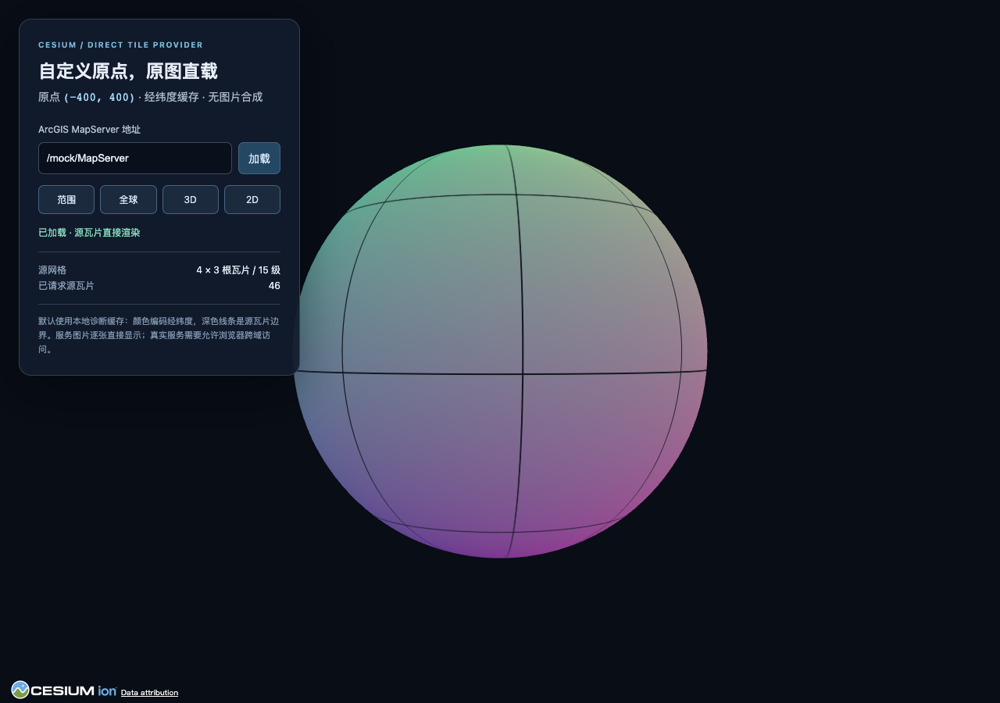
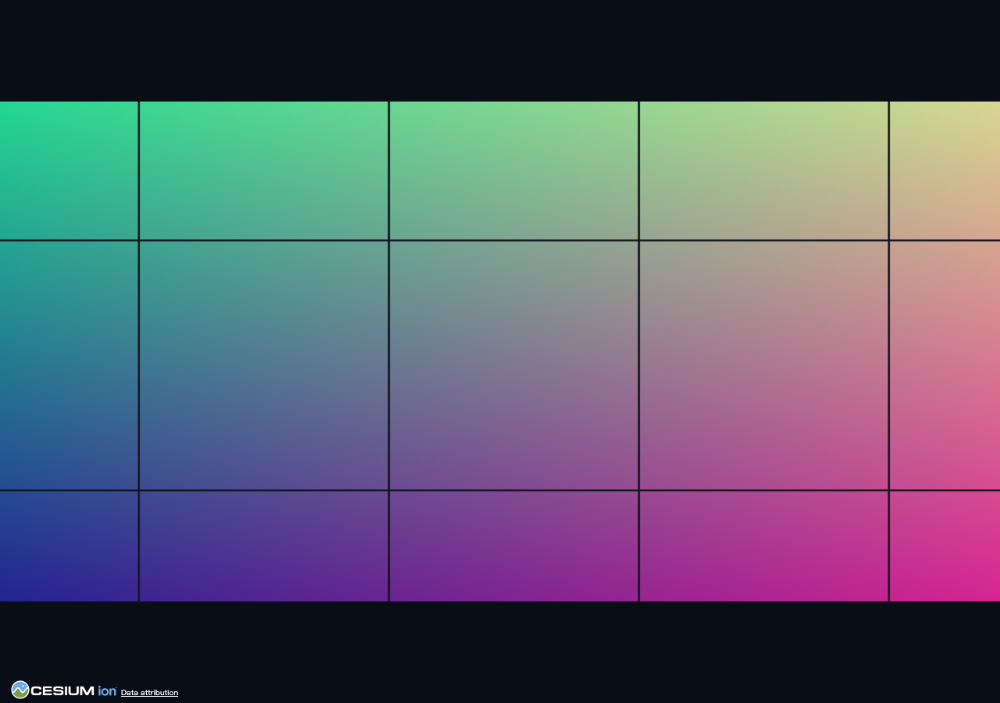

# 验证记录

日期：2026-10-22。项目版本：0.1.1。运行版本：Node.js 24.13.0、Cesium 1.146.0、本机 Chrome 的无界面 WebGL/SwiftShader 渲染。

本记录验证的是本仓库内的模拟 ArcGIS 缓存，原点为 `(-400,400)`，256×256，零级分辨率 `0.703125°/像素`，随后逐级减半。没有接入用户的真实 ArcGIS 服务。

## 已通过

- 23 项 Node 测试：原始切片索引、父子关系、弧度/度转换、单源图片直接请求、调度限流透传、认证参数继承、LOD 标签映射、错误响应及元数据约束、服务版权保留。
- 真实 Cesium `ImageryLayer` 测试：每个全球地形根瓦片与四张源图关联，相邻地形块复用源影像，极区/日期变更线保留完整图片 UV，影像 LOD 与标准网格一致。包含 LOD 0/2/6、整数与小数原点、日期线两侧与两极的 24 组组合，以及区域 overlay 的范围裁剪与源图 UV。
- TypeScript 严格检查：可直接传入 Cesium 的影像层 API，无需类型断言。
- Vite 生产构建及生产预览中的 3D/2D 浏览器检查。
- 14 项浏览器像素断言：6 个 3D 点、6 个 2D 点、区域内外各 1 点；区域自动定位、过期成功响应、过期失败响应、新服务失败时保留旧影像均通过。
- 浏览器无未捕获运行错误或控制台错误；本次运行请求了 453 个不同的源瓦片 URL。请求数量随视角、时序和设备而变化，不作为性能基准。
- 独立空项目安装 `.tgz` 包后，通过 ESM 导入、源网格计算、Cesium 图层创建与包内文档检查。
- npm 依赖审计：0 个已报告漏洞。

同一代码版本也已通过 GitHub Actions 的 Ubuntu / Node.js 24 / Playwright Chromium 完整检查，含浏览器回归与打包检查：[CI 运行记录（8c1884b）](https://github.com/daizhonggeng/cesium-arcgis-origin-provider/actions/runs/39752948342)。后续仅调整演示按钮文字与本验证记录、截图；按钮调整另经构建和单行显示检查。

浏览器以地理位置定位，然后从截图中读取对应像素，与服务生成的经纬度编码色比较，允许每通道最多 3 的取样误差：

| 经度 | 纬度 | 期望 RGB | 3D 实测 RGB | 2D 实测 RGB |
| --- | --- | --- | --- | --- |
| 0 | 0 | 125,125,145 | 125,125,145 | 125,125,145 |
| 110 | 35 | 180,160,145 | 180,160,145 | 180,160,145 |
| 179 | 15 | 215,140,145 | 215,140,145 | 215,140,145 |
| -179 | -20 | 36,105,145 | 36,105,145 | 36,104,145 |
| 25 | 84 | 138,209,145 | 138,209,145 | 138,208,145 |
| 20 | -84 | 135,41,145 | 135,41,145 | 135,41,145 |

区域服务覆盖 `[100,20,120,40]` 度时，区内 `(110,30)` 实测为 `180,155,145`，与源图一致；区外 `(0,0)` 为地球底色 `27,37,54`，没有把区域边缘拉伸过去。

3D 逐点及区域功能检查使用 `640×480` 视口，以降低软件 WebGL 的极区细化负载；文档截图和 2D 检查使用 `1280×900`。每次采样仍要求 `globe.tilesLoaded=true` 连续 6 帧，30 秒内未完成会失败。失败时另存 `artifacts/browser-failure.json` 和截图，记录请求数量及加载队列，便于区分网络失败与渲染尚未完成。

这验证了原点改变后的定位与纹理映射，不构成真实服务器的缓存完整性、CORS、认证或性能验收。

## 复现

```sh
npm ci
# 无可用浏览器时：npx playwright install chromium
npm run check
```

检查程序生成 `artifacts/browser-report.json`、`artifacts/demo-3d.png` 与 `artifacts/demo-2d.png`。`artifacts/` 是本地生成目录，不提交 Git。

## 参考截图

诊断缓存的深色线条是源图片边界，用于观察覆盖及父子关系，不是正常地图内容。




